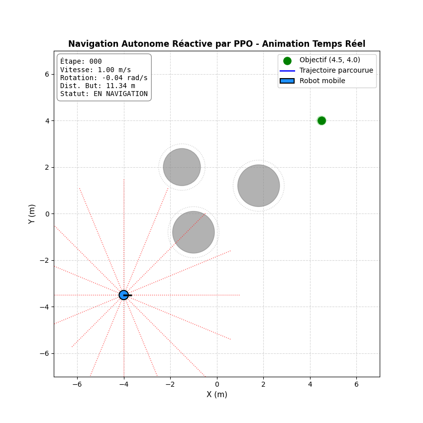
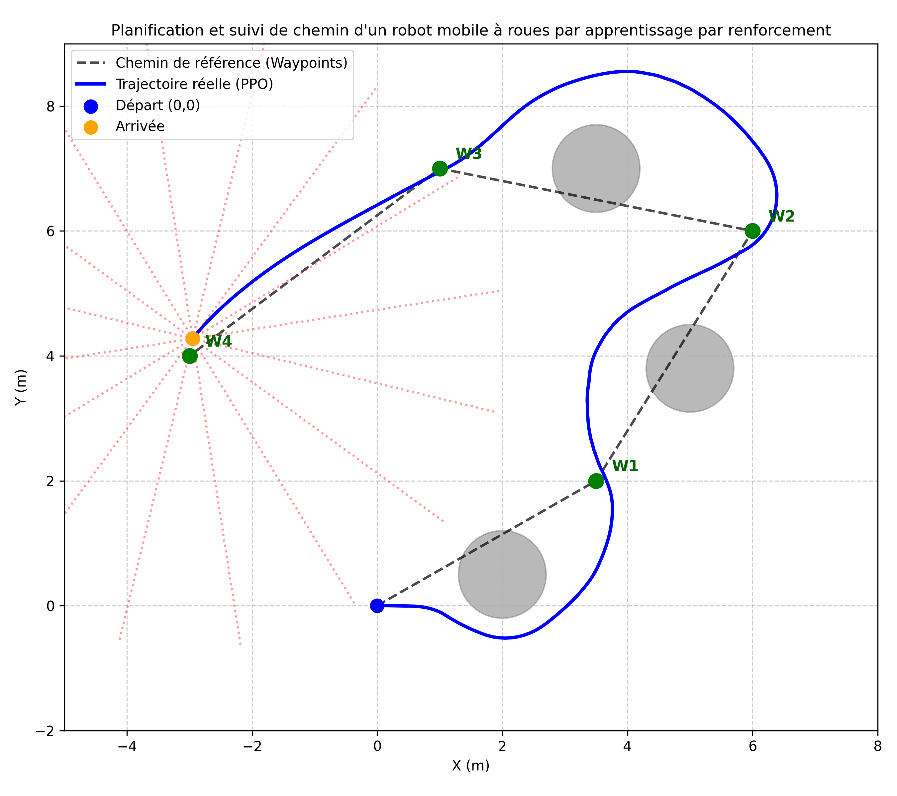
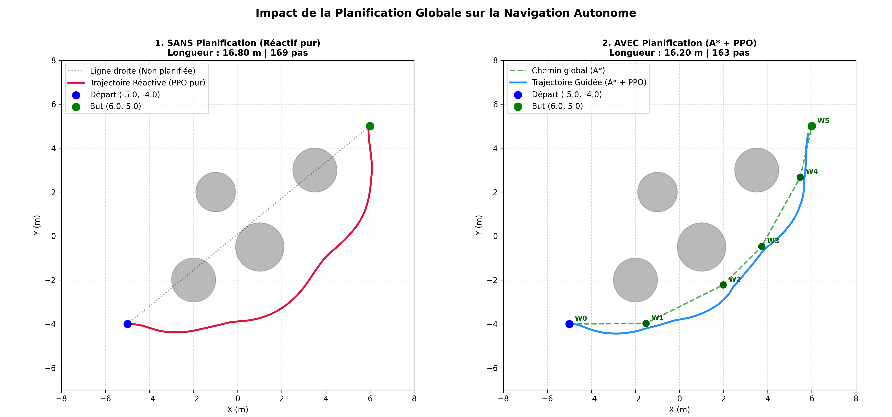

# Planification et suivi de chemin d'un robot mobile à roues par l'apprentissage par renforcement


> **Path Planning and Trajectory Following for a Wheeled Mobile Robot via Reinforcement Learning**  
> An autonomous navigation framework combining non-holonomic unicycle kinematics, analytical 2D LiDAR raycasting, Gymnasium integration, continuous Deep Reinforcement Learning (PPO), and A* global planning.

---

## 📽️ Aperçu en Temps Réel (Real-Time Animation)



*Animation en direct montrant le robot unicycle adaptant ses vitesses $(v, \omega)$ en temps réel grâce à ses 16 faisceaux LiDAR pour contourner les obstacles et rallier la cible.*

---

## 📌 Architecture du Système

Le projet implémente une architecture hiérarchique à deux niveaux, conforme aux standards de l'industrie (ex. **ROS 2 Nav2**) :

```
                        [ Carte / Environnement 2D ]
                                     │
                                     ▼
                     1. PLANIFICATEUR GLOBAL (A*)
             Calcul du macro-itinéraire autour des obstacles
             Sortie : Waypoints discrets [W0, W1, W2, ... Wn]
                                     │
                                     ▼
                     2. CONTRÔLEUR LOCAL RÉACTIF (PPO)
             Suivi de chemin + Évitement réactif d'obstacles
             Entrée : LiDAR (16 faisceaux) + Cap relatif
             Sortie : Commandes moteurs continues (v, ω)
```

---

## 🔬 Modélisation Mathématique & Formulation

### 1. Cinématique Unicycle Non-Holonome
Le robot est modélisé par un système unicycle différentiel à vitesse linéaire $v \in [0, 1.0]\text{ m/s}$ et vitesse angulaire $\omega \in [-1.0, 1.0]\text{ rad/s}$ :

$$\begin{cases}
\dot{x} = v \cos(\theta) \\
\dot{y} = v \sin(\theta) \\
\dot{\theta} = \omega
\end{cases}$$

L'intégration temporelle est discrétisée par la méthode d'Euler avec un pas $\Delta t = 0.1\text{ s}$ :
$$x_{t+1} = x_t + v_t \cos(\theta_t) \Delta t, \quad y_{t+1} = y_t + v_t \sin(\theta_t) \Delta t, \quad \theta_{t+1} = \text{atan2}(\sin(\theta_t + \omega_t \Delta t), \cos(\theta_t + \omega_t \Delta t))$$

### 2. Télédétection LiDAR Analytique (Raycasting)
Chaque faisceau est modélisé par un rayon $R(t) = P_{\text{robot}} + t \cdot \vec{d}$ avec $t \in [0, d_{\max}]$. L'intersection avec un obstacle circulaire de rayon $r$ centré en $C = (x_c, y_c)$ se résout analytiquement via l'équation quadratique :

$$\| P_{\text{robot}} + t \vec{d} - C \|^2 = r^2 \iff t^2 + 2 (\vec{u} \cdot \vec{d}) t + (\|\vec{u}\|^2 - r^2) = 0$$

où $\vec{u} = P_{\text{robot}} - C$. La distance mesurée correspond à la plus petite racine positive $t > 0$.

### 3. Fonction de Récompense (PBRS - Potential-Based Reward Shaping)
Pour éviter les boucles de récompense (*reward cycles*) et garantir la convergence théorique selon le théorème de Ng et al. (1999), le système utilise un potentiel basé sur la distance euclidienne $\Phi(s) = -d(s, \text{goal})$ :

$$R(s, a, s') = (d_{\text{prev}} - d_{\text{curr}}) - 0.01 + R_{\text{terminal}}$$

$$\text{avec } R_{\text{terminal}} = \begin{cases} +100 & \text{si } d_{\text{curr}} \le \text{tolerance (But atteint)} \\ -100 & \text{si collision détectée} \\ 0 & \text{sinon} \end{cases}$$

### 4. Domain Randomization (Généralisation Zero-Shot)
Pour empêcher le surapprentissage (*overfitting*), chaque épisode réinitialise aléatoirement :
- La pose de départ du robot : $x, y \sim \mathcal{U}(-3.5, 3.5)\text{ m}$, $\theta \sim \mathcal{U}(-\pi, \pi)$.
- La position de la cible : distance minimale $\ge 3.5\text{ m}$.
- Nombre variable d'obstacles : $N \in \{1, 2, 3\}$ avec rayons aléatoires $r \sim \mathcal{U}(0.6, 0.9)\text{ m}$ positionnés par échantillonnage par rejet.

---

## 📊 Résultats Expérimentaux & Benchmarks

### 1. Benchmark Quantitatif (100 Épisodes Aléatoires)
Évaluation systématique du modèle PPO sur 100 scénarios inédits répartis en 4 niveaux de difficulté :

| Niveau de Difficulté | Obstacles | Taux de Succès | Taux de Collision | Taux de Timeout | Pas Moyens | Efficacité de Chemin |
| :--- | :---: | :---: | :---: | :---: | :---: | :---: |
| **Facile** | 1 | **100.0%** | **0.0%** | 0.0% | 67.6 | 84.6% |
| **Moyen** | 2 | **100.0%** | **0.0%** | 0.0% | 74.0 | 86.4% |
| **Nominal** | 3 | **84.0%** | **0.0%** | 16.0% | 82.6 | 82.6% |
| **Haute Densité (Stress Test)** | 5 | **88.0%** | **0.0%** | 12.0% | 84.8 | 76.9% |

> **Constat majeur :** Taux de collision de **0.0%** sur l'ensemble des 100 tests. Le modèle privilégie systématiquement la sécurité physique.

---

### 2. Suivi de Chemin Multi-Waypoints (Path Following)



Le modèle PPO enchaîne le ralliement de waypoints successifs tout en gonflant sa trajectoire de manière réactive pour contourner les obstacles présents sur les segments.

---

### 3. Comparatif : Navigation Réactive vs Navigation Hiérarchique



- **À gauche (PPO Pur Réactif)** : Le robot est myope. Il subit des déviations tardives et doit effectuer un virage en crochet abrupt pour rallier la cible ($16.80\text{ m}$).
- **À droite (A* Global + PPO Local)** : Le planificateur global anticipe les couloirs dégagés en amont. L'agent PPO négocie une trajectoire parabolique fluide et optimale ($16.20\text{ m}$).

---

## 📁 Structure du Projet

```text
robot-simulator/
├── src/robot_simulator/
│   ├── kinematics.py          # Modèle unicycle et intégration d'Euler
│   ├── controllers.py         # Contrôleur proportionnel et calcul d'erreur de cap
│   ├── obstacles.py           # Dataclass CircularObstacle et moteur de collision
│   ├── lidar.py               # Raycasting analytique 2D (16 faisceaux)
│   ├── simulation.py          # Boucles de simulation et visualiseur Matplotlib
│   ├── a_star.py              # Planificateur global A* sur grille d'occupation
│   └── envs/
│       └── robot_nav_env.py   # Environnement Gymnasium continu (Observation 18D, Action 2D)
├── tests/                     # 38 tests unitaires Pytest (couverture complète)
├── scripts/
│   ├── train.py               # Entraînement PPO (200,000 pas) avec Domain Randomization
│   ├── evaluate.py            # Évaluation d'une politique unicycle
│   ├── evaluate_waypoints.py  # Suivi séquentiel de waypoints (Path Following)
│   ├── evaluate_hierarchical.py # Pipeline A* Global + PPO Local
│   ├── compare_planning.py    # Benchmark comparatif côté-à-côté
│   ├── benchmark.py           # Évaluation statistique sur 100 épisodes
│   └── animate.py             # Visualiseur animé temps réel & exporteur GIF
├── models/
│   └── ppo_robot_nav.zip      # Poids du réseau de neurones PPO entraîné
├── requirements.txt           # Dépendances épinglées
├── pyproject.toml             # Configuration du package pip installable
└── pytest.ini                 # Configuration du lanceur de tests
```

---

## 🚀 Installation & Utilisation

### 1. Installation de l'Environnement
```bash
git clone https://github.com/bader/robot-simulator.git
cd robot-simulator

# Création de l'environnement virtuel (recommandé)
python -m venv .venv
source .venv/bin/activate  # Sous Windows : .venv\Scripts\activate

# Installation du package en mode éditable
pip install -e .
pip install -r requirements.txt
```

### 2. Exécution des Tests Unitaires
```bash
pytest
```
*Doit afficher `38 passed`.*

### 3. Lancer l'Animation Temps Réel
```bash
python scripts/animate.py
```

### 4. Lancer le Benchmark Quantitatif (100 Épisodes)
```bash
python scripts/benchmark.py
```

### 5. Comparer la Navigation Réactive et Hiérarchique
```bash
python scripts/compare_planning.py
```

---

## 📜 Licence
Projet distribué sous licence MIT. Voir `LICENSE` pour plus de détails.
